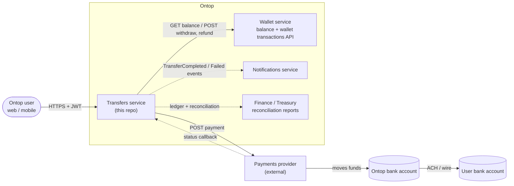
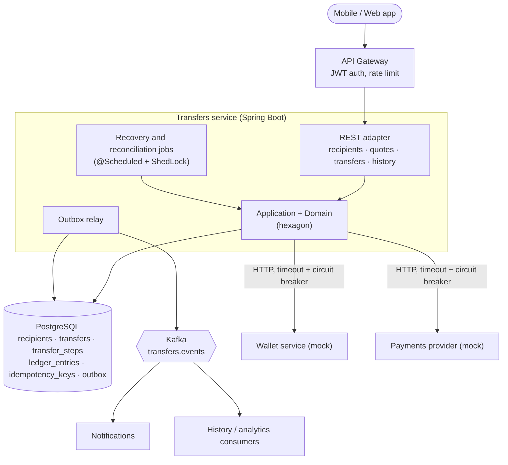
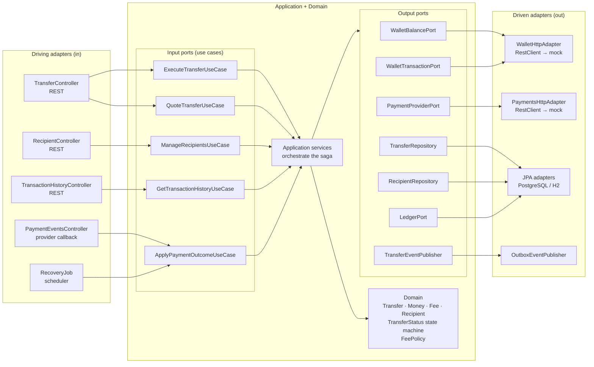
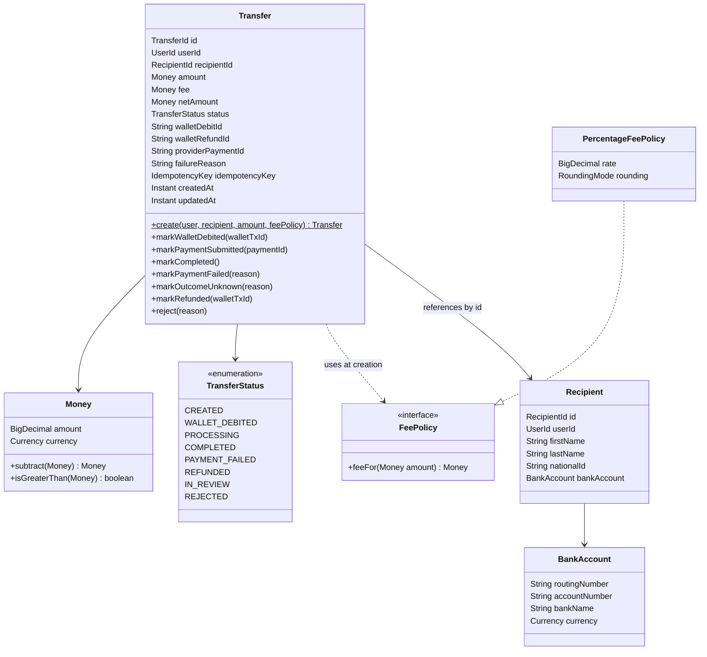
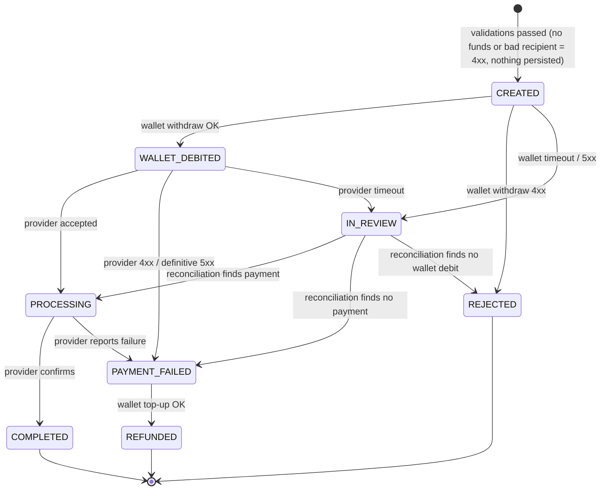
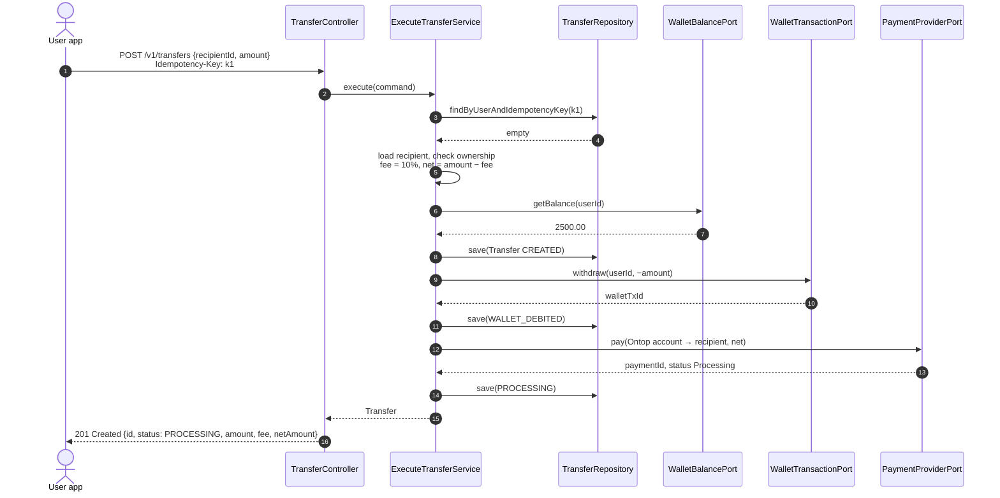
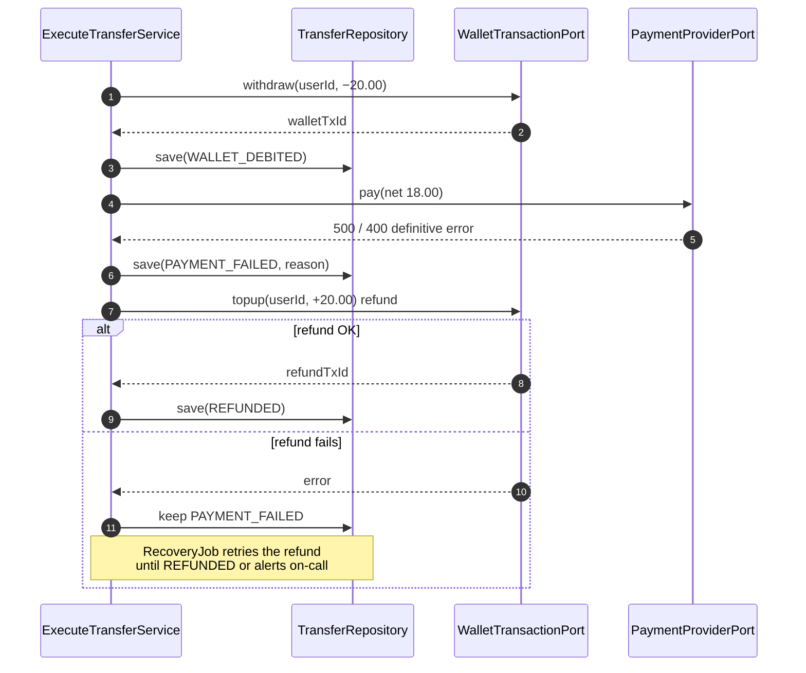
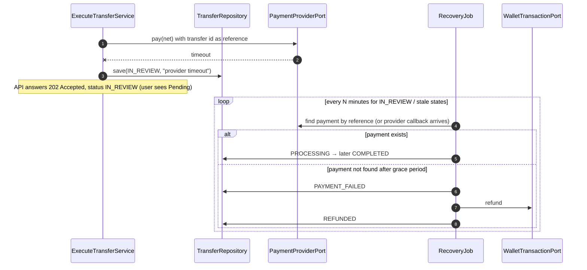
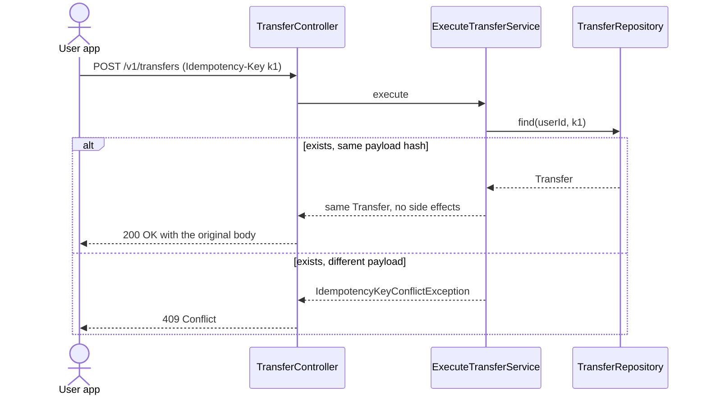
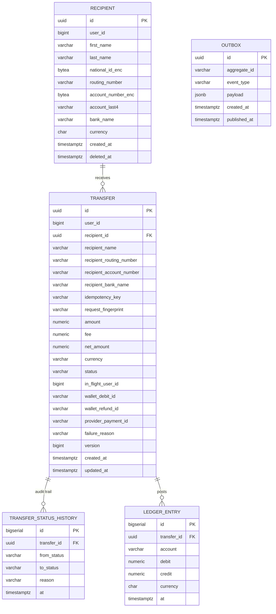

# Architecture Design — Wallet to Bank Withdrawal

Related decisions: [ADR 001](adr/001-hexagonal-architecture.md) · [ADR 002](adr/002-transfer-saga-debit-first.md) · [ADR 003](adr/003-fee-policy-and-money.md) · [ADR 004](adr/004-idempotency-and-concurrency.md) · [ADR 005](adr/005-ledger-and-reconciliation.md)

| Legend | Meaning |
|---|---|
| ✅ Coded | Implemented and covered by tests |
| 🟡 Stubbed | Port + adapter with the real contract, minimal logic or seeded data |
| ⬜ Designed | Documented only |

---

## 1. Problem in one paragraph

A user has a **wallet**: a virtual balance backed by Ontop's single bank account. To withdraw, two independent systems must change: the **Wallet transactions API** (internal) lowers the user's balance, and the **Payments API** (external provider) moves real money from Ontop's bank account to the user's bank account. Neither system knows about the other, and there is no distributed transaction across them. The core of this design is therefore **keeping both sides consistent when one of them fails or times out**.

## 2. Screens → capabilities

| Screen | Capability | Endpoint | Status |
|---|---|---|---|
| "We need some information about your recipient's bank account" | Save a recipient bank account | `POST /v1/recipients` | ⬜ |
| (pick from saved accounts) | List / delete saved accounts | `GET /v1/recipients`, `DELETE /v1/recipients/{id}` | ⬜ |
| "How much money do you want to send?" — available funds | Read wallet balance | `GET /v1/wallet/balance` | ⬜ |
| "How much money do you want to send?" — fee / recipient gets | Quote a transfer | `POST /v1/transfers/quotes` | ⬜ |
| Continue | **Execute the transfer** | `POST /v1/transfers` | ✅ |
| Transfer detail | Read one transfer | `GET /v1/transfers/{id}` | 🟡 |
| "Recent transactions" | Transaction history | `GET /v1/transactions` | ⬜ |
| (async) | Provider status callback / polling | `POST /internal/v1/payment-events` or scheduler | ⬜ |

## 3. System context (C4 level 1)



## 4. Containers (C4 level 2)



**Scope for the coded part:** REST adapter, hexagon, PostgreSQL/H2 with Flyway, HTTP adapters for the three mocks. Kafka, outbox relay, gateway and jobs are designed only.

## 5. Hexagonal view (ports and adapters)



**Dependency rule** (enforced by an ArchUnit test): `domain` depends on nothing; `application` depends only on `domain`; `adapter.*` depends on `application` and `domain`; nothing depends on `adapter`. Spring annotations live in adapters and in a single `config` package that wires beans. Details in [ADR 001](adr/001-hexagonal-architecture.md).

## 6. Domain model



- `Transfer` is the aggregate. **Every status change goes through a method** that validates the transition and throws `IllegalTransferTransitionException` otherwise; there are no public setters.
- `Money` is an immutable value object (`BigDecimal`, scale 2, currency). Invariant: `amount = fee + netAmount`.
- `Recipient` snapshot (name, routing, account) is **copied into the transfer** at creation, so editing or deleting a saved account never rewrites history.

## 7. Transfer state machine



| Internal status | Money state | User sees (history screen) |
|---|---|---|
| `CREATED` | Nothing moved yet | Pending |
| `WALLET_DEBITED` | Wallet −amount, bank untouched | Pending |
| `PROCESSING` | Wallet −amount, provider moving net amount | Pending |
| `COMPLETED` | Final | "Bank transfer to your account · Transaction completed" |
| `PAYMENT_FAILED` | Wallet −amount, must refund | Pending |
| `REFUNDED` | Wallet restored | "Refund from bank transfer · Refunded to your wallet" |
| `IN_REVIEW` | **Unknown** — the system does not guess | Pending |
| `REJECTED` | Nothing moved | Failed |

The key rule: **a timeout is not a failure.** If the provider times out, the payment may have been executed; refunding immediately could pay the user twice. The transfer goes to `IN_REVIEW` and the reconciliation job decides. See [ADR 002](adr/002-transfer-saga-debit-first.md).

## 8. Sequences

### 8.1 Happy path (coded)



### 8.2 Provider fails → compensation (coded)



The full amount (20.00, fee included) is refunded: the user is never charged a fee for a transfer that did not happen.

### 8.3 Provider timeout → reconciliation (designed)



If the provider has no lookup by reference, `IN_REVIEW` transfers go to a manual review queue for Finance (see [open questions](open-questions.md)).

### 8.4 Idempotent retry



## 9. Data model



- `UNIQUE (user_id, idempotency_key)` on `transfer`.
- `UNIQUE (in_flight_user_id)`, a column equal to `user_id` only while the status is `CREATED` or `WALLET_DEBITED` → at most one transfer per user in the debit phase (see [ADR 004](adr/004-idempotency-and-concurrency.md)).
- `CHECK (amount = fee + net_amount)` so the money invariant also holds at the storage level.
- `version` column for optimistic locking (`@Version`), so two writers (request thread and recovery job) cannot overwrite each other.
- `national_id` and `account_number` encrypted at the application layer (AES-GCM, key from KMS / Vault); only `account_last4` is returned by the API.
- `ledger_entry` is append-only; see [ADR 005](adr/005-ledger-and-reconciliation.md).

**Coded scope:** `recipient` (seeded with Flyway) and `transfer`. History, ledger and outbox tables are designed.

## 10. API design

Authentication is by JWT at the gateway; the user id comes from the token (`sub`). In the coded version, which has no auth, the user id travels in the `X-User-Id` header so the controller does not change when auth is added.

| Method | Path | Purpose | Success | Status |
|---|---|---|---|---|
| POST | `/v1/recipients` | Save a bank account | 201 | ⬜ |
| GET | `/v1/recipients` | List saved accounts (masked) | 200 | ⬜ |
| DELETE | `/v1/recipients/{id}` | Soft delete | 204 | ⬜ |
| GET | `/v1/wallet/balance` | Available funds | 200 | ⬜ |
| POST | `/v1/transfers/quotes` | Fee and net amount for an amount | 200 | ⬜ |
| **POST** | **`/v1/transfers`** | **Execute a transfer** | **201 / 202 / 200 replay** | ✅ |
| GET | `/v1/transfers/{id}` | Transfer detail | 200 | 🟡 |
| GET | `/v1/transactions?cursor=&limit=&type=` | History, newest first, cursor pagination | 200 | ⬜ |
| POST | `/internal/v1/payment-events` | Provider callback (signed) | 204 | ⬜ |

### Execute transfer contract

```http
POST /v1/transfers
X-User-Id: 1000
Idempotency-Key: 7f9c2a0e-1c55-4f7b-9a63-3f0d6b2d1e10
Content-Type: application/json

{ "recipientId": "b3b8...", "amount": 20.00, "currency": "USD" }
```

```http
HTTP/1.1 201 Created
Location: /v1/transfers/5d1e...

{
  "id": "5d1e...",
  "status": "PROCESSING",
  "amount": 20.00,
  "fee": 2.00,
  "netAmount": 18.00,
  "currency": "USD",
  "recipient": { "name": "Lucho Rodriguez", "bankName": "Bank of America", "accountLast4": "9907" },
  "createdAt": "2026-10-27T15:04:05Z"
}
```

Response code depends on what happened to the money:

| Outcome | HTTP | Body `status` |
|---|---|---|
| Provider accepted the payment | 201 | `PROCESSING` |
| Provider failed, refund done | 201 | `REFUNDED` (with `failureReason`) |
| Provider failed, refund pending | 201 | `PAYMENT_FAILED` |
| Outcome unknown (timeout) | 202 | `IN_REVIEW` (shown to the user as pending) |
| Same Idempotency-Key, same body | 200 | original body |

A transfer that reached the provider is a real resource with an audit trail, so it is returned as 201 even if it later failed; the client reads `status`. Errors **before any money moves** use error codes (next section).

## 11. Error handling

Domain and application throw typed exceptions; a single `@RestControllerAdvice` maps them to [RFC 9457](https://www.rfc-editor.org/rfc/rfc9457) `application/problem+json`.

| Exception | Raised by | HTTP | `type` / code |
|---|---|---|---|
| `MethodArgumentNotValidException` | Bean Validation | 400 | `invalid-request` |
| `InvalidAmountException` | `Money` / `Transfer` | 400 | `invalid-amount` |
| `MissingIdempotencyKeyException` | controller | 400 | `idempotency-key-required` |
| `RecipientNotFoundException` | application | 404 | `recipient-not-found` (also when it belongs to another user) |
| `InsufficientFundsException` | domain | 422 | `insufficient-funds` |
| `IdempotencyKeyConflictException` | application | 409 | `idempotency-key-conflict` |
| `TransferInProgressException` | repository (unique index) | 409 | `transfer-in-progress` |
| `WalletUserNotFoundException` | wallet adapter (mock 404) | 404 | `wallet-not-found` |
| `WalletUnavailableException` | wallet adapter (mock 500, timeout, CB open) | 503 + `Retry-After` | `wallet-unavailable` |
| `IllegalTransferTransitionException` | domain | 500 (bug, alert) | `internal-error` |
| any other | — | 500, no stack trace in body | `internal-error` |

Provider errors are **not** HTTP errors for the client: they change the transfer status (sections 7 and 10). Adapters translate HTTP and transport errors into domain exceptions, so the application never sees `HttpClientErrorException` or `SocketTimeoutException`.

## 12. Integration with the mocks

> The Postman collection was not included in the PDF. The contracts below are **assumptions to confirm** (see [open questions](open-questions.md)); only the adapters change if they differ.

| Port | Mock | Assumed request | Responses used |
|---|---|---|---|
| `WalletBalancePort` | `GET /wallets/balance?user_id={id}` | — | 200 `{ balance, user_id }` |
| `WalletTransactionPort` | `POST /wallets/transactions` | `{ user_id, amount }` (negative = withdraw, positive = top-up) | 200 `{ wallet_transaction_id, amount, user_id }`, 400, 404 (unknown user), 500 |
| `PaymentProviderPort` | `POST /api/v1/payments` | `{ source: { type: COMPANY, sourceInformation: { name }, account: { accountNumber, currency, routingNumber } }, destination: { name, account: {...} }, amount }` | 200 `{ requestInfo: { status }, paymentInfo: { id, amount } }`, 400, 500 (failure), 500 (timeout) |

- Ontop's source account (name, account number, routing number, currency) is **configuration** (`ontop.payments.source.*`), never request input.
- Each adapter has its own timeouts (connect 2 s, read 5 s for wallet, 10 s for provider). Designed, not coded: a Resilience4j circuit breaker per adapter and retries **only on idempotent calls** (balance GET). The wallet withdrawal and the payment POST are never retried blindly, because the mocks give no idempotency guarantee.

## 13. Cross-cutting concerns

| Concern | Decision |
|---|---|
| Observability | Micrometer metrics per status transition and per adapter (latency, errors, CB state); `traceId` propagated with Micrometer Tracing and logged with `transferId`, `userId`. |
| Alerts | Transfers in `IN_REVIEW` or `PAYMENT_FAILED` older than 15 min; reconciliation mismatch > 0; circuit breaker open. |
| Security | JWT at the gateway, ownership check on every recipient/transfer, PII encrypted at rest and masked in logs, provider callbacks verified by HMAC signature, secrets from env / Vault. |
| Limits | Per-user rate limit at the gateway; configurable min/max amount per transfer and daily limit (AML). |
| Configuration | Fee rate, Ontop account, mock URLs, timeouts in `application.yml` with `@ConfigurationProperties` validation at startup. |

## 14. What is coded vs. designed

See [implementation-plan.md](implementation-plan.md). In short: the `POST /v1/transfers` vertical slice (controller → use case → domain → wallet/payments adapters → JPA) with compensation on provider failure and `IN_REVIEW` on timeout, plus tests per layer. Recipients CRUD, quotes, history, outbox, callbacks and reconciliation are designed here and listed as next steps.
